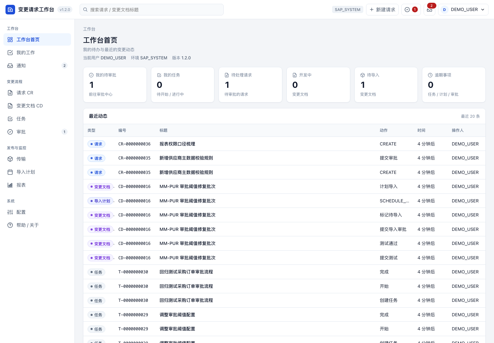
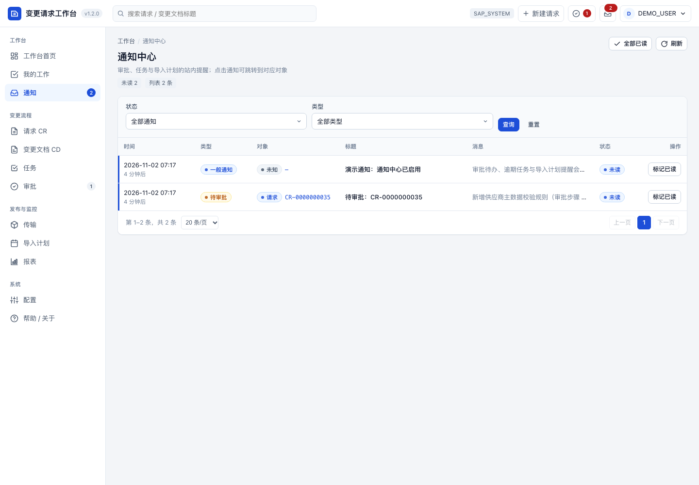
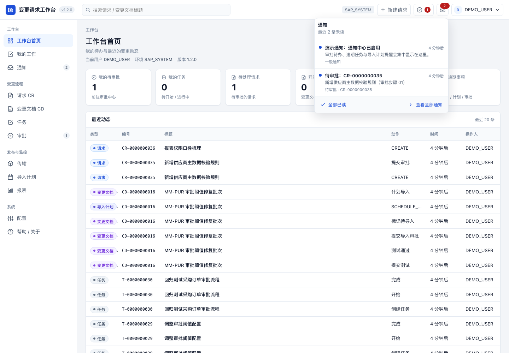
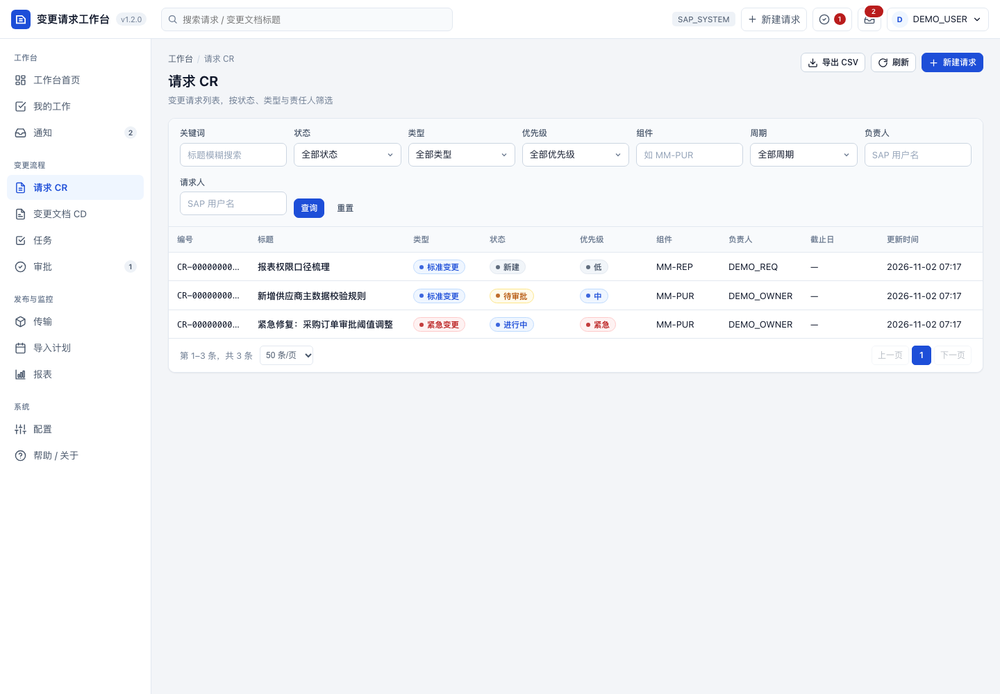
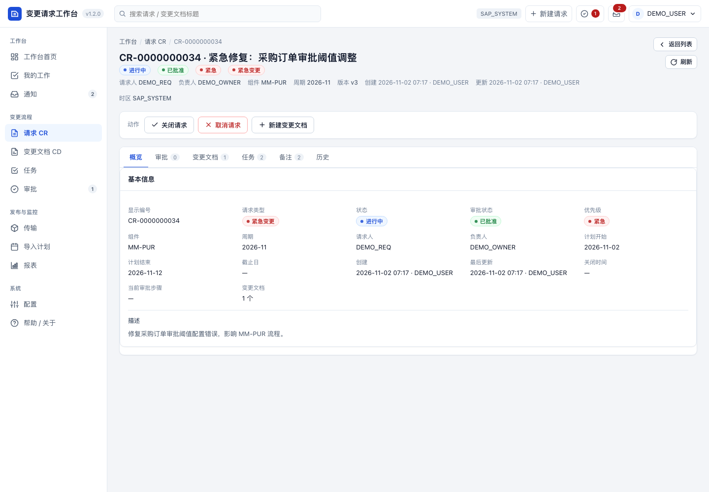
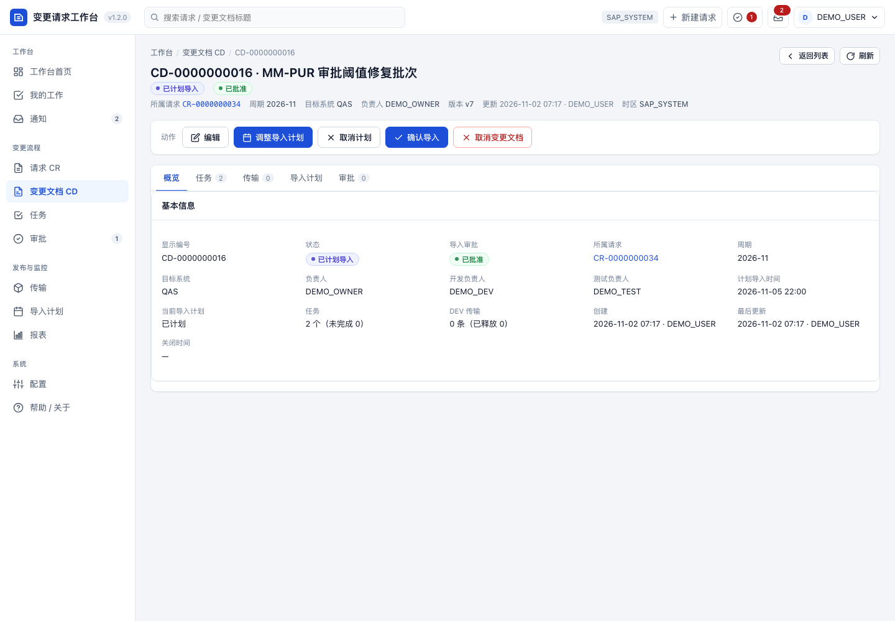
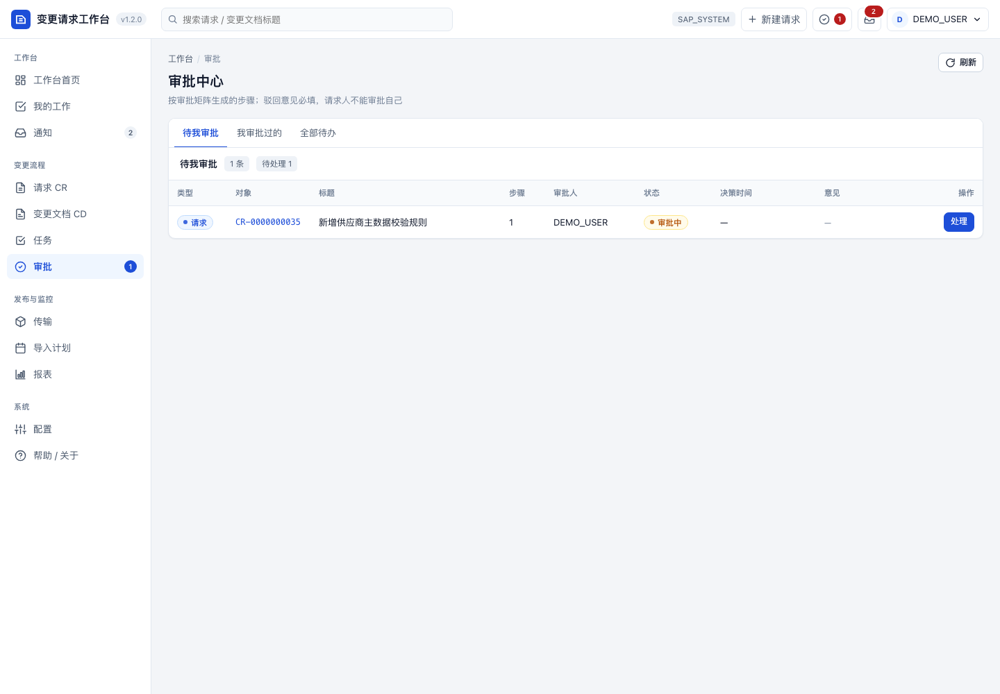
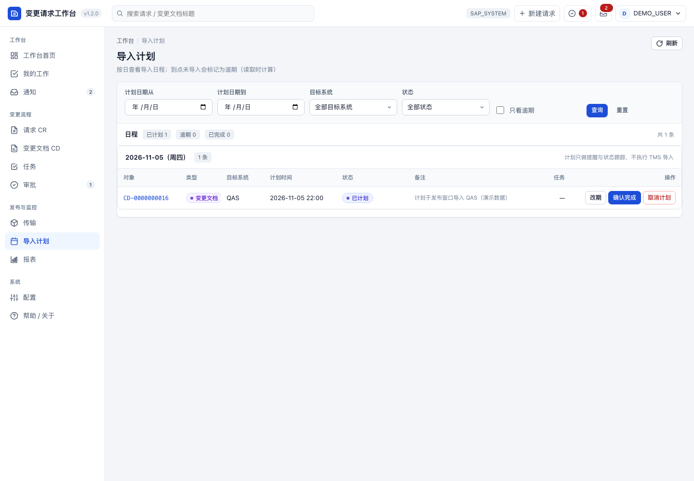
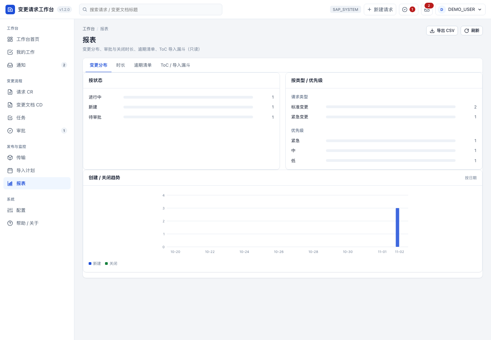

# 变更请求工作台（CRW）

> 状态：M1（API + SPA + ICF/事务码）→ M2（流程闭环 + 审批 + 锁）→ M3（CTS 只读 + 传输 + 导入计划）→ M4（报表 + 配置 + 迁移/产品化）→ **M5 / P2 站内通知中心 + 提醒作业（2026-11-02）** 已实现；P2 其余项见文末。
> 这是**真实应用**，不是 demo；不套用 demo 的 `DMA` 命名与编号，契约见仓库 [`AGENTS.md`](../../AGENTS.md) §4A。
> 产品规划与决策记录：[docs/change-request-workbench-plan.md](../../docs/change-request-workbench-plan.md)（D11–D25 / W1–W30 已冻结）。
> 架构与流程契约：[docs/architecture.md](docs/architecture.md)、[docs/workflow.md](docs/workflow.md)；P2 basis 类项设计：[docs/p2-basis.md](docs/p2-basis.md)。
> 安装 / 升级 / 运维：[docs/runbook.md](docs/runbook.md)。交接文档：[docs/handoff.md](docs/handoff.md)。

在 SAP 内管理「变更请求 → 变更文档 → 任务/子任务 → 传输（含 ToC）→ 测试 → 计划导入 → 关闭」的全流程工作台：工作清单、详情、审批、传输视图、导入计划、仪表盘、报表、审计与**站内通知**。

## 范围

- CR → CD → Task → SubTask 层级；CR/CD/Task 状态机、审批矩阵、历史审计、乐观锁 + SAP 锁对象。
- Transport 关联（DEV / ToC），CTS 只读展示与手工关联（D4/D8：不创建、不释放、不导入 transport）。
- 导入计划（计划时间/窗口 + 日程 + 逾期计算 + 导入确认，不执行 TMS 导入）。
- 站内通知中心：审批待办 / 驳回 / 逾期任务 / 逾期计划提醒；顶栏铃铛 + `#/notifications` 页面；每日提醒报表 `ZCRW_REMIND_JOB`（SM36 由 basis 配置，本轮不建）。
- 变更请求类型：`STD` / `URG` / `ADM`（ADM 检查清单 P2；新增/编辑/提交/撤回 `CR` 已支持）。

## 当前状态（2026-11-02）

- 预检：abap-cli 2.0.1（`abap --version`；升级后 `abap deploy --yes` 刷新内置 ICF 并 `deploy status` current）；`abap doctor` ok；profile `test`（systemVersion 789）。
- 包：`$CRW` 本地包（super package `$TMP`，无 transport；**不可跨系统部署**）。
- 数据模型：14 张 `ZCRW_*` 表（M5 新增 `ZCRW_NOTIFY`）、3 个号段（`ZCRW_REQ`/`ZCRW_CD`/`ZCRW_TASK`）、消息类 `ZCRW_MSG`、锁对象 `EZCRW_REQ`/`EZCRW_CD`（锁参数 `REQ_ID`/`CD_ID` 已激活）。
- 服务层：`ZCL_CRW_UTIL` / `_NUMBER` / `_AUDIT` / `_AUTH` / `_WORKFLOW` / `_APPR_SVC` / `_SCHEDULE_SVC` / `_REQUEST_SVC` / `_CD_SVC` / `_TASK_SVC` / `_TRANSPORT_SVC` / `_REPORT_SVC` / `_NOTIFY`（通知）/ `_BOOTSTRAP` / `_MIGRATION` / `_SELFCHECK` / `_M1_SMOKE` / `_TEST_DATA` / `_DEMO_DATA`、`ZIF_CRW_CTS_READER` + `ZCL_CRW_CTS_ADAPTER`、`ZCX_CRW_ERROR`。
- API：ICF 节点 `ZCRW_APP` → `/sap/bc/zcrw`（`ZCL_CRW_HTTP_HANDLER` + `ZCL_CRW_API_ROUTER`），统一 JSON 信封、写保护头 `X-CRW-Request: 1`、乐观锁 `version`、错误码 → HTTP 400/401/403/404/409/500/502。
  - CR / CD / Task / SubTask：列表（筛选/排序/白名单/分页）、创建、详情、PATCH、动作（状态机 + 守卫 + 角色）、历史、备注。
  - 审批：审批矩阵生成步骤、待我审批/已审批、决策（驳回必填意见、禁止自审、ANY 规则、SKIP）。
  - 传输：关联/解绑/标记不再关联/同步快照、E070/E071/E07T 只读、`degraded` 降级。
  - 计划：列表/改期/取消/确认、逾期计算、CD 计划快照同步。
  - 报表：变更分布/趋势、审批/关闭时长、逾期清单、ToC 漏斗、CSV 导出。
  - 配置：周期/角色/审批矩阵/号段只读；`/health` 组件健康、`/me` 角色、`/dashboard` KPI + 动态。
  - **通知（M5）**：`/notifications`（列表：状态/类型/分页）、`/notifications/unread-count`、`/notifications/refresh`、`/notifications/{id}/read`、`/notifications/read-all`；写请求需 `X-CRW-Request: 1`。
- 前端：`src/mime/` 原生 ES modules 单页（零依赖/零构建），16 个页面 + 顶栏通知铃铛/动作条/审批抽屉/时间线/表格组件；部署于 MIME `/zcrw`。
- 入口：事务码 `ZCRW`（报表事务 → `ZCRW_START`，运行时展示 `<system-url>/sap/bc/zcrw/`，不写死地址）。
- 初始化：`ZCL_CRW_BOOTSTRAP` **v1.2.0**（号段 + 版本 + REQ/CD 审批矩阵 + ADMIN/CHANGE_MANAGER 角色），幂等；`ZCL_CRW_MIGRATION` 单步前向迁移。
- 自检：`ZCL_CRW_SELFCHECK` 只读，覆盖 14 表（含 `ZCRW_NOTIFY`）、通知数、号段、版本、消息类、角色、审批矩阵、ICF 节点（TADIR SICF）、E070 只读。
- 提醒作业：`ZCRW_REMIND_JOB` 报表（扫描待审批 / 逾期任务 / 逾期计划生成通知）；SM36 作业 `ZCRW_REMIND` 由 basis 配置，本轮不建。
- 邮件：`ZCL_CRW_NOTIFY=>deliver_email` 预留；SMTP 未配置时**不发信**（P2，需 basis 配 SCOT）。

## 安装与初始化

完整顺序、命令模板与失败路由见 [docs/runbook.md](docs/runbook.md) §2。简要：

1. `abap deploy status --json` 确认 ICF current；`abap check content` / `abap validate:aff` 静态校验。
2. 按依赖顺序 `check syntax` → `push` → `inspect --activation`（DDIC（含 `ZCRW_NOTIFY`）→ 号段/锁/消息类 → 基础类 → 服务/控制器（含 `ZCL_CRW_NOTIFY` / `ZCL_CRW_API_NOTIFY`）→ 报表 `ZCRW_REMIND_JOB` → `ZCL_CRW_HTTP_HANDLER`）。
3. 创建 ICF 节点 `ZCRW_APP`（AFF `src/zcrw_app.http.json`，`create` 用带顶层 `name` 的临时副本）；随后再 `abap activate ZCL_CRW_HTTP_HANDLER` 刷新 ICF 类缓存。
4. 创建事务码 `ZCRW`（`src/zcrw.tran.json` → `ZCRW_START`）并 push `src/zcrw_start.prog.abap`。
5. MIME：先建 `/zcrw`、`/zcrw/js`、`/zcrw/js/components`、`/zcrw/js/pages`，再按层级 `mime push`（`mime push` 会扁平化目录，勿整目录推送到 `/zcrw`）。
6. `abap run ZCL_CRW_BOOTSTRAP --json` → `abap run ZCL_CRW_MIGRATION --json` → `abap run ZCL_CRW_SELFCHECK --json`（M5 起期望 `tables=14 version=1.2.0`）。
7. 开发/演示数据（非只读）：`abap run ZCL_CRW_DEMO_DATA --json`（含通知种子）；复位：`abap run ZCL_CRW_TEST_DATA --json`（清 `ZCRW_NOTIFY`）。
8. 可选：需要每日提醒时，由 basis 按 [docs/runbook.md](docs/runbook.md) §2.13 创建 SM36 作业 `ZCRW_REMIND`（应用不自动建作业；SMTP 未配置时只生成站内通知）。

## 运行与验证（只读）

```bash
abap run ZCL_CRW_SELFCHECK --json        # 14 表/号段/版本/消息/角色/矩阵/通知/ICF/CTS，期望 CRW_SELFCHECK_OK tables=14 version=1.2.0 icf=OK cts=OK
abap run ZCL_CRW_NOTIFY --json           # 通知服务只读探测，期望 CRW_NOTIFY_OK rows=<n> unread=<n>
abap run ZCL_CRW_JSON --json             # JSON camelCase/时间转换自检，期望 CRW_JSON_OK
abap test ZCL_CRW_UTIL --json            # ABAP Unit（util）
abap test ZCL_CRW_WORKFLOW --json        # ABAP Unit（状态机，10 用例）
abap test ZCL_CRW_JSON --json            # ABAP Unit（JSON，8 用例）
abap test ZCL_CRW_NOTIFY --json          # ABAP Unit（通知，5 用例；实测 5/5 通过）
abap select --table DD02L --where "TABNAME LIKE 'ZCRW%'" --count-only --json   # 期望 count=14
abap select --table ZCRW_NOTIFY --count-only --json                            # 通知行数（复位后为 0；演示数据后为 2，未读 2）
abap select --table NRIV --where "OBJECT LIKE 'ZCRW%'" --json
abap select --table T100 --where "ARBGB = 'ZCRW_MSG'" --json
abap tcode ZCRW --json                   # 期望解析到 ZCRW_START / screen 1000
```

HTTP 自检（浏览器登录后，用运行环境地址替换 `<host>`；仓库不记录系统地址）：

- `GET <host>/sap/bc/zcrw/` → SPA 首页；`/js/app.js`、`/js/pages/notifications.js` 等静态资源 200。
- `GET <host>/sap/bc/zcrw/api/v1/health` → `data.status=ok`、`components.icf=ok`、`version=1.2.0`。
- `GET <host>/sap/bc/zcrw/api/v1/me` → 当前用户/角色/`version=1.2.0`。
- `GET <host>/sap/bc/zcrw/api/v1/requests?page=1&size=20`、`.../reports/changes`、`.../transports`、`.../schedules`、`.../config/approval-matrix` 均返回只读 JSON。
- `GET <host>/sap/bc/zcrw/api/v1/notifications?status=UNREAD&size=5`、`.../notifications/unread-count` → 只读 JSON（`data.items[]` / `data.count`）。
- 页面 `#/notifications` 可见通知列表与顶栏铃铛；点击条目跳转 `linkPage`（无链接回退 `#/notifications`）。

> `ZCL_CRW_BOOTSTRAP` / `_MIGRATION` / `_M1_SMOKE` / `_DEMO_DATA` / `_TEST_DATA` 会写数据，属安装/开发步骤，不在只读验证清单内。`abap run-report ZCRW_REMIND_JOB` 会写 `ZCRW_NOTIFY`，属运维步骤（runbook §2.13）。CTS（E070/E071/E07T/TMSBUFFER）只读。

## 主页面截图

`screenshots/`（1440×1000，M5 / v1.2.0 实拍，演示数据 + 脱敏：页面内用户显示为 `DEMO_*`，无系统地址/客户端；顶栏含通知铃铛与未读数）：

| 工作台 | 通知中心 | 通知铃铛面板 |
|---|---|---|
|  |  |  |
|  |  |  |
|  |  |  |

> 截图与当前 `src/` + 已部署的 MIME 资产一致；脱敏口径（无 URL/client/真实数据）见 [runbook](docs/runbook.md) §10。

## 目录

```
apps/change-request-workbench/
├── README.md
├── docs/            # architecture / workflow / runbook / handoff / p2-basis
├── src/             # AFF：DDIC / CLAS / INTF / HTTP / TRAN / PROG / NROB / ENQU / MSAG
├── src/mime/        # 前端资产（原生 ES modules）
└── screenshots/     # 主页面截图（脱敏）
```

## 边界与已知限制

- 本地包 `$CRW` 无 transport，**不可跨系统部署**；跨系统需迁移到可传输包（本轮暂不做，设计见 [docs/p2-basis.md](docs/p2-basis.md) §2，A19）。
- CTS 只读：不创建/释放/删除 transport、不执行 TMS 导入；导入状态以快照/降级展示（D4/D8）。
- 计划只做提醒与状态跟踪；逾期在读取时计算（系统本地时间，D16/W22）；站内通知已实现，SM36 每日作业由 basis 配置（本轮不建）。
- 通知按用户隔离、`dedup_key` 去重；邮件通道预留、SMTP 未配置时**不发信**；`DISMISSED` 枚举预留、无忽略端点。
- 审批规则 v1 = ANY（任一人通过）；ALL/改派/事后补审为 P2。
- 索引未建（A20 / D20，后置）、数据归档未做（A18，只设计）、权限对象未建（A8，只设计）；见 [docs/p2-basis.md](docs/p2-basis.md)。
- 配置页面只读；周期/矩阵/角色维护走 bootstrap 或 SAP GUI（P2）。
- UI 截图来自 SPA 资产 + 演示数据，用户标识替换为 `DEMO_*`；系统地址不出现在截图与仓库；M5 截图（含通知中心/铃铛）已重拍。

## 工作约定

- 所有 `abap create/pull` 在本目录执行，避免拉取文件落到仓库根 `src/`。
- 对象前缀 `ZCRW_` / `ZCL_CRW_` / `ZIF_CRW_` / `ZCX_CRW_`；包 `$CRW`。
- 写 SAP 顺序：`check content` / `validate:aff` → `check syntax` → `push` → `inspect --activation` / `run` / `test`。
- 不 release transport；不碰生产；不提交凭证、URL、真实业务数据。

## 下一步（P2）

1. P2 basis 类项：可传输包迁移、二级索引、数据归档、权限对象、Fiori/FLP（本轮只出设计，见 [docs/p2-basis.md](docs/p2-basis.md)）。
2. 邮件通道（basis 配 SCOT 后启用 `deliver_email`）与 SM36 每日作业 `ZCRW_REMIND`（basis 配置）。
3. 审批 ALL 规则/改派/事后补审；ADM 检查清单；配置页面编辑；报表日期范围参数化。
