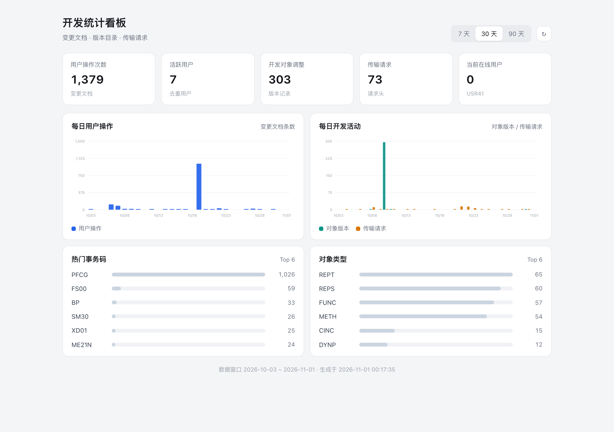
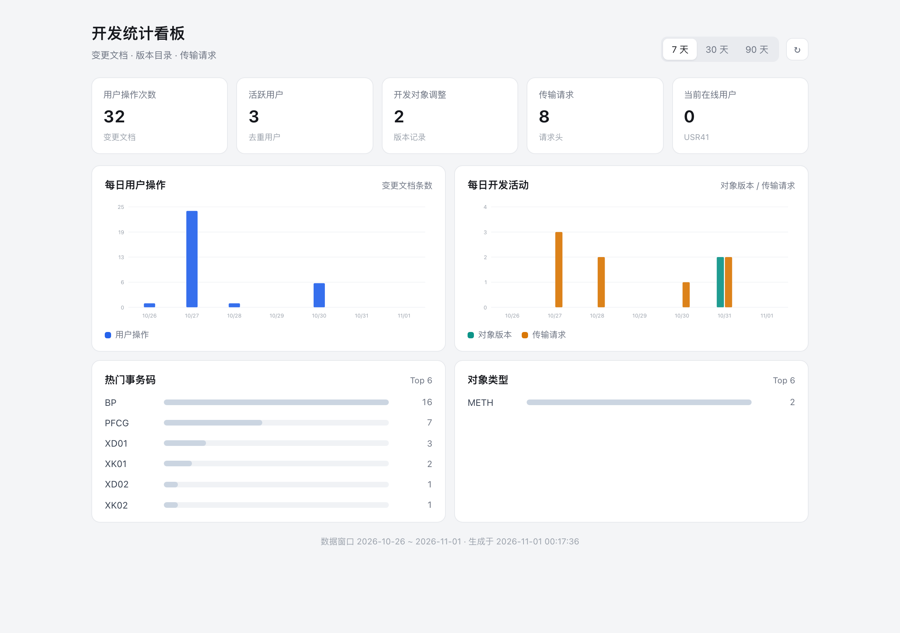

# 01 ICF + MIME 统计看板

用 ICF 服务节点 + MIME Repository 静态资源，把 SAP 近 N 天的开发与操作统计渲染成一个可交互的单页看板。

## 场景与目标

不引入 Fiori / 前端框架，只用 SAP 自带能力做一块统计看板：ICF 服务节点提供 JSON 接口并托管页面，MIME Repository 存放 HTML/CSS/JS，页面按天展示用户操作、开发对象调整与传输请求趋势。

数据口径（本环境实测确认）：

| 指标 | 数据源 | 口径 | 说明 |
|---|---|---|---|
| 用户操作次数 | `CDHDR` | 窗口内变更文档条数，按天聚合 | 数据变更操作，**不是**登录/访问次数 |
| 活跃用户 | `CDHDR` | 窗口内 `USERNAME` 去重计数 | 只展示数量，不展示用户名 |
| 开发对象调整 | `VRSD` | 窗口内版本目录条目数，按天聚合 | 对象版本记录 |
| 传输请求 | `E070` | 窗口内 `AS4DATE` 请求/任务头数量 | 按天聚合 |
| 当前在线用户 | `USR41` | 当前会话去重计数 | 实时值 |

系统级“访问/登录次数”在本环境不可得，因此不展示：ST03N 工作负载采集数据停在 2024-06（`SWNCMONI` 无 2026 年数据），ICF 服务日志 `ICFLOG`/`ICF_SERV_STAT` 为空，安全审计日志缓冲表 `RSAU_BUF_DATA` 为空且审计文件无近期数据。

## 原始 Prompt

```text
目标：在 SAP dev 系统的 $TMP 中创建 ICF 服务节点 ZDMA_01_STATS、handler 类
ZCL_DMA_01_STATS 与 MIME 根目录 /zdma_01_stats，实现一个可交互的开发统计看板：
页面通过 ICF JSON 接口读取近 N 天 CDHDR/VRSD/E070/USR41 统计并渲染。

前置条件：
- abap-cli 已配置 dev/trial profile，abap doctor --json 全部 ok
- 系统为 S/4HANA（依赖 IF_HTTP_EXTENSION、CL_MIME_REPOSITORY_API、ABAP SQL）
- ICF 通道可用（abap deploy status --json 的 data.installed=true）；本 demo 不修改内置 ICF 服务
- 只写 $TMP；不创建 transport；不修改其他对象

实现契约：
- 对象：
  - ZCL_DMA_01_STATS（CLAS，$TMP）：实现 IF_HTTP_EXTENSION 与 IF_OO_ADT_CLASS_RUN
  - ZDMA_01_STATS（HTTP，$TMP）：servicePath=/sap/bc/zdma_01_stats，handlerClass=ZCL_DMA_01_STATS
  - MIME 根目录 /zdma_01_stats（$TMP）：index.html、app.js、styles.css
  - ZCL_DMA_01_STATS_CLEANUP（CLAS，$TMP）：临时 classrun，只在 S9 清理时创建，
    用 CL_ICF_TREE 删除 ICF 节点（abap delete 没有 SICF 删除端点）
- 路由（~path_info）：
  - 空 / "/" / "/index.html" → 返回 MIME 的 index.html
  - "/app.js"、"/styles.css" → 返回对应 MIME 资产
  - "/api/stats" → 返回统计 JSON
  - 其他 → 404 JSON
- JSON 契约（GET /api/stats?days=N）：
  - days 默认 30，夹取到 [7,90]
  - 顶层：status=ok、days、fromDate、toDate、generatedAt、
    kpi{userOps,activeUsers,devObjects,transports,onlineUsers}、
    series[{date,userOps,devObjects,transports}]（窗口内每天一行，缺失补 0）、
    topTcodes[{name,count}]、topObjectTypes[{name,count}]（各 Top 6）
  - 不返回用户名；tcodes / objtypes 为技术标识
- 数据口径：
  - userOps = CDHDR 条数（UDATE 在窗口内，按天聚合）
  - activeUsers = 窗口内 CDHDR.USERNAME 去重数
  - devObjects = VRSD 条数（DATUM 在窗口内，按天聚合）
  - transports = E070 条数（AS4DATE 在窗口内，按天聚合）
  - onlineUsers = USR41 当前行数
- classrun 自检：if_oo_adt_classrun~main 输出 DMA_STATS_OK + KPI 摘要；逐个读取 MIME
  三个资产，全部存在输出 DMA_MIME_OK（缺失输出 DMA_MIME_FAIL <file>）；最后输出统计 JSON
- 页面要求：中文、无外部依赖（不引用 CDN）、asset 用绝对路径
  /sap/bc/zdma_01_stats/...、不展示用户名/系统地址/client/真实业务数据
- 代码风格：遵循 .agents/skills/abap-style/SKILL.md；ADT 类源码在方法之间不接受 `*` 注释块，
  类内注释使用 `"` 行内注释

执行步骤：

S1 预检
- 目的：确认 CLI 与 ICF 通道可用
- 命令：abap doctor --json；abap deploy status --json
- 期望：doctor status=success 且 data.environment[].status 均为 ok；deploy status data.installed=true
- 失败：CONFIG_ERROR/AUTH_ERROR → 读 .agents/skills/abap-cli-setup/SKILL.md；ICF unreachable → 停止并报告

S2 复位
- 目的：保证 demo 可重跑
- 命令：
  abap search ZCL_DMA_01_STATS --type CLAS --exact --json
  abap select --table ICFSERVICE --where "ICF_NAME = 'ZDMA_01_STATS'" --count-only --json
  abap mime delete /zdma_01_stats --recursive --yes --json
- 期望：mime delete 成功或 NOT_FOUND
- 若类存在：abap delete ZCL_DMA_01_STATS --type CLAS --yes --json
- 说明：ICF 节点无需在 S2 删除——S7 的 create HTTP 对已存在节点原地更新
  （data.action=updated）；彻底删除节点见 S9 的临时 classrun 流程
- 失败：OBJECT_NOT_FOUND → 已不存在，继续

S3 创建类
- 目的：创建 handler 类骨架并落本地文件
- 命令：abap create CLAS ZCL_DMA_01_STATS --package '$TMP' --description 'DMA demo 01 ICF+MIME stats dashboard handler' --yes --json
- 期望：status=success、data.activated=true、data.localFile=src/zcl_dma_01_stats.clas.abap
- 失败：OBJECT_EXISTS → 回 S2；VALIDATION_ERROR → 检查 '$TMP' 是否单引号、--yes 是否缺失

S4 实现 handler
- 目的：按实现契约实现类（参考实现见本目录 src/zcl_dma_01_stats.clas.abap）
- 动作：编辑 src/zcl_dma_01_stats.clas.abap
- 约束：遵循 .agents/skills/abap-style/SKILL.md；类内注释用 `"`，不要用方法间的 `*` 注释块
- 失败：不适用

S5 语法检查与推送
- 目的：把实现写到 SAP 并激活
- 命令：
  abap check syntax src/zcl_dma_01_stats.clas.abap --json
  abap push src/zcl_dma_01_stats.clas.abap --yes --json
  abap inspect ZCL_DMA_01_STATS --activation --json
- 期望：check data.failure=false；push data.failed=0、data.results[0].activated=true；
  inspect data.activation.ok=true
- 失败：SYNTAX_ERROR → 读 error.details.issues[] 修复后重跑 S5；
  ACTIVATION_FAILED → 读 error.details.results[].messages[] 修复后重跑 S5

S6 创建 MIME 目录并上传前端资产
- 目的：把页面资产放到 MIME Repository
- 命令：
  abap mime create /zdma_01_stats --package '$TMP' --description 'DMA demo 01 stats dashboard assets' --yes --json
  abap mime push src/mime --root /zdma_01_stats --yes --json
- 期望：create data.action=created；push data.uploaded=3
- 失败：OBJECT_EXISTS → 先 abap mime delete /zdma_01_stats --recursive --yes --json 再重跑 S6；
  NOT_FOUND → 检查 create 是否成功

S7 创建 ICF 节点
- 目的：把 handler 挂到 /sap/bc/zdma_01_stats
- 动作：src/zdma_01_stats.http.json 是 AFF 规范文件；CLI create 还需要顶层 CLI 信封字段 name，
  先在 tmp/ 生成带 name 的临时副本（内容相同，仅顶层加 "name": "ZDMA_01_STATS"）
- 命令：abap create HTTP ZDMA_01_STATS --file tmp/zdma_01_stats.create.http.json --package '$TMP' --description 'DMA demo 01 ICF+MIME stats dashboard' --yes --json
- 期望：status=success、data.action=created（节点已存在时为 updated，属于幂等更新）
- 失败：VALIDATION_ERROR Missing required field: name → 检查临时副本是否含顶层 name；
  HTTP_CREATE_FAILED → 检查 handlerClass 是否已激活、servicePath 是否冲突、父节点 /sap/bc 是否存在

S8 验收
- 目的：只读验证数据层、MIME 资产与 ICF 节点
- 命令：
  abap run ZCL_DMA_01_STATS --json
  abap select --table ICFSERVICE --where "ICF_NAME = 'ZDMA_01_STATS'" --count-only --json
  abap select --table ICFHANDLER --fields ICF_NAME,ICFORDER,ICFTYP,ICFHANDLER --where "ICF_NAME = 'ZDMA_01_STATS'" --json
- 期望：run 的 data.output 含 DMA_STATS_OK 与 DMA_MIME_OK，且含 "status":"ok"；
  ICFSERVICE data.count=1；
  ICFHANDLER data.rowCount=1、data.rows[0].ICFHANDLER=ZCL_DMA_01_STATS、ICFTYP=A
- 失败：DMA_MIME_FAIL → 回 S6；ICF 行缺失 → 回 S7

S9 清理
- 目的：删除 demo 全部对象（含 ICF 节点）
- 说明：abap delete 不支持 SICF 节点（--type HTTP 会 OBJECT_NOT_FOUND），
  用临时 classrun 类 ZCL_DMA_01_STATS_CLEANUP 删除节点
- 命令：
  abap delete ZCL_DMA_01_STATS_CLEANUP --type CLAS --yes --json
  abap create CLAS ZCL_DMA_01_STATS_CLEANUP --package '$TMP' --description 'DMA demo 01 ICF node cleanup' --yes --json
  abap check syntax src/zcl_dma_01_stats_cleanup.clas.abap --json
  abap push src/zcl_dma_01_stats_cleanup.clas.abap --yes --json
  abap run ZCL_DMA_01_STATS_CLEANUP --json
  abap delete ZCL_DMA_01_STATS_CLEANUP --type CLAS --yes --json
  abap delete ZCL_DMA_01_STATS --type CLAS --yes --json
  abap mime delete /zdma_01_stats --recursive --yes --json
  abap search ZCL_DMA_01_STATS --type CLAS --exact --json
  abap select --table ICFSERVICE --where "ICF_NAME = 'ZDMA_01_STATS'" --count-only --json
  abap select --table ICFHANDLER --where "ICF_NAME = 'ZDMA_01_STATS'" --count-only --json
- 期望：run 输出 DMA_CLEANUP_OK（节点不存在时输出 DMA_CLEANUP_SKIP）；
  delete 均 data.deleted=true；search 无匹配；两个 count=0；mime delete data.action=deleted
- 失败：OBJECT_NOT_FOUND → 已清理，继续；LOCK_FAILED → 读 .agents/skills/abap-cli-edit/SKILL.md

验收标准：
- S5–S8 期望全部满足
- S2–S9 连续执行两次（含复位）核心断言一致（S7 首次 created、再次 updated）
- data.output 同时包含 DMA_STATS_OK 与 DMA_MIME_OK
- ICFSERVICE count=1、ICFHANDLER rowCount=1，handler 指向 ZCL_DMA_01_STATS
- S9 后 ICFSERVICE/ICFHANDLER count=0、MIME 目录不存在、两个类均无匹配

清理：
- 见 S9；清理后 ZCL_DMA_01_STATS 搜索无匹配、ICFSERVICE/ICFHANDLER count=0
```

## 实现说明

### 对象清单

| 对象 | 类型 | 包 | 说明 |
|---|---|---|---|
| `ZCL_DMA_01_STATS` | CLAS | `$TMP` | ICF handler（`IF_HTTP_EXTENSION`）+ classrun 自检；数据聚合、JSON 序列化、MIME 读取 |
| `ZDMA_01_STATS` | HTTP | `$TMP` | ICF/SICF 节点：`/sap/bc/zdma_01_stats`，handler 指向 `ZCL_DMA_01_STATS` |
| MIME `/zdma_01_stats` | MIME 根目录 | `$TMP` | 前端资产：`index.html` / `app.js` / `styles.css` |
| `ZCL_DMA_01_STATS_CLEANUP` | CLAS | `$TMP` | 临时 classrun（仅清理时创建）：用 `CL_ICF_TREE` 删除 ICF 节点 |

### API 契约

`GET /sap/bc/zdma_01_stats/api/stats?days=30`（`days` 默认 30，夹取 `[7,90]`）：

```json
{
  "status": "ok",
  "days": 30,
  "fromDate": "2026-10-02",
  "toDate": "2026-10-31",
  "generatedAt": "2026-10-31 23:59:21",
  "kpi": { "userOps": 1380, "activeUsers": 7, "devObjects": 303, "transports": 73, "onlineUsers": 0 },
  "series": [{ "date": "2026-10-02", "userOps": 1, "devObjects": 0, "transports": 0 }],
  "topTcodes": [{ "name": "PFCG", "count": 1026 }],
  "topObjectTypes": [{ "name": "REPT", "count": 65 }]
}
```

### 关键设计

- 路由基于 `~path_info`；页面与接口同源，`app.js` 用相对 `api/stats` 请求，`index.html` 用绝对 asset 路径，裸节点 URL（无尾斜杠）也能正确加载。
- 统计全部在 ABAP 侧用 Open SQL 聚合；`series` 在 ABAP 里按天补齐，前端不推断日期。
- 不返回用户名，页面只展示计数、事务码与对象类型，便于截图脱敏。
- classrun 自检（`abap run`）把数据层与 MIME 资产检查串起来，README 的验证不需要访问 ICF URL。
- 内置 ICF 服务版本为 1.0.0（CLI 期望 1.1.0），本 demo 只使用稳定的 MIME/HTTP 通道；`abap deploy status` 的 `ICF_OUTDATED_DEADLOCK` 告警不影响本 demo。
- `abap delete` 对 SICF 节点没有删除端点（`--type HTTP` 报 `OBJECT_NOT_FOUND`），因此清理用一个临时 classrun 调 `CL_ICF_TREE` 删节点；该临时类用完即删，不参与正常流程。

### 静态校验

- `abap check content src/zcl_dma_01_stats.clas.abap --json`：本地结构校验，期望 `data.failure=false`。
- `abap check content src/zcl_dma_01_stats_cleanup.clas.abap --json`：同上（临时清理类）。
- `abap check syntax src/zcl_dma_01_stats.clas.abap --json`：SAP 侧语法检查，期望 `data.failure=false`。
- `abap validate:aff src/zdma_01_stats.http.json --json`：期望 `status=success`（仓库内的 `.http.json` 是规范 AFF 文件，不含 CLI 信封字段）。
- MIME 资产为静态前端文件，无 AFF schema；用 `abap mime push --dry-run` 预览、实际 push 后由 classrun 自检兜底。

### src/ 文件

- `src/zcl_dma_01_stats.clas.abap` — handler + classrun 自检（参考实现）
- `src/zcl_dma_01_stats_cleanup.clas.abap` — 临时 classrun：删除 ICF 节点（参考实现）
- `src/zdma_01_stats.http.json` — ICF 节点 AFF 定义
- `src/mime/index.html`、`src/mime/app.js`、`src/mime/styles.css` — MIME 前端资产

## 运行与验证

前置：已按“原始 Prompt”完成 S1–S7。以下命令均为只读。

```bash
abap run ZCL_DMA_01_STATS --json

abap select --table ICFSERVICE \
  --where "ICF_NAME = 'ZDMA_01_STATS'" --count-only --json

abap select --table ICFHANDLER --fields ICF_NAME,ICFORDER,ICFTYP,ICFHANDLER \
  --where "ICF_NAME = 'ZDMA_01_STATS'" --json
```

期望：

- `abap run`：`status=success`、`data.exitCode=0`、`data.output` 包含 `DMA_STATS_OK` 与 `DMA_MIME_OK`，且包含 `"status":"ok"`。
- `ICFSERVICE`：`data.count=1`（节点存在；`ICF_NOACT` 为空表示已激活）。
- `ICFHANDLER`：`data.rowCount=1`、`data.rows[0].ICFHANDLER=ZCL_DMA_01_STATS`、`data.rows[0].ICFTYP=A`。

人工检查（可选）：浏览器访问路径 `/sap/bc/zdma_01_stats/`（不含主机），应看到看板页面；效果见下方截图。

## 截图





截图取自真实 dev 系统页面（Basic Auth 渲染），不包含用户名、系统地址、client 或真实业务数据。

## 清理

```bash
# 1) 用临时 classrun 删除 ICF 节点（abap delete 不支持 SICF 节点）
abap delete ZCL_DMA_01_STATS_CLEANUP --type CLAS --yes --json
abap create CLAS ZCL_DMA_01_STATS_CLEANUP --package '$TMP' --description 'DMA demo 01 ICF node cleanup' --yes --json
abap check syntax src/zcl_dma_01_stats_cleanup.clas.abap --json
abap push src/zcl_dma_01_stats_cleanup.clas.abap --yes --json
abap run ZCL_DMA_01_STATS_CLEANUP --json
abap delete ZCL_DMA_01_STATS_CLEANUP --type CLAS --yes --json

# 2) 主对象
abap delete ZCL_DMA_01_STATS --type CLAS --yes --json
abap mime delete /zdma_01_stats --recursive --yes --json

# 3) 断言
abap search ZCL_DMA_01_STATS --type CLAS --exact --json
abap select --table ICFSERVICE --where "ICF_NAME = 'ZDMA_01_STATS'" --count-only --json
abap select --table ICFHANDLER --where "ICF_NAME = 'ZDMA_01_STATS'" --count-only --json
```

期望：`abap run` 输出 `DMA_CLEANUP_OK`（节点不存在时 `DMA_CLEANUP_SKIP`）；delete 均 `data.deleted=true`；search 无匹配；两个 `count=0`；再次 `mime delete` 报 `NOT_FOUND`。

## 常见错误

| `error.code` | 处理 |
|---|---|
| `OBJECT_EXISTS`（MIME） | 目录或资源已存在：`abap mime delete /zdma_01_stats --recursive --yes --json` 后重跑 S6 |
| `VALIDATION_ERROR`（create HTTP） | 文件缺顶层 CLI 信封字段 `name`：按 S7 生成带 `name` 的临时副本 |
| `HTTP_CREATE_FAILED` | 检查 handlerClass 是否已激活、`servicePath` 是否冲突、父节点 `/sap/bc` 是否存在 |
| `OBJECT_NOT_FOUND`（delete） | 对象已不存在；ICF 节点按 S9 的临时 classrun 删除（`delete --type HTTP` 不支持 SICF） |
| `SYNTAX_ERROR` / `ACTIVATION_FAILED` | 读 `error.details.issues[]` 或 `error.details.results[].messages[]` 修复后重跑 S5 |
| `NOT_FOUND`（mime delete） | 目录已不存在，无需处理 |
| `WRAPPER_INPUT_UNAVAILABLE`（run --method） | 本系统不支持 classrun 参数注入；清理改用临时 classrun 类，不用 `--method` |
